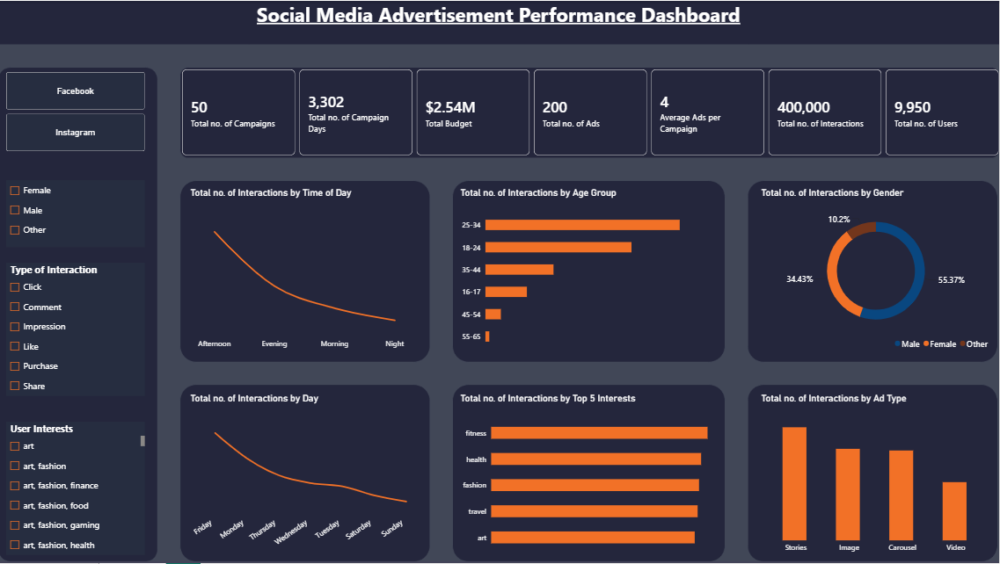

# Social Media Advertisement Performance Dashboard (Power BI)

> An interactive Power BI dashboard that analyzes social media advertisement performance to identify how audience targeting and ad scheduling can be refined to increase conversions within a fixed budget.

## Table of Contents
- [Overview](#overview)
- [Dashboard Preview](#dashboard-preview)
- [Business Question](#business-question)
- [Data Source](#data-source)
- [Tools & Technologies](#tools--technologies)
- [Data Model](#data-model)
- [Data Preparation](#data-preparation)
- [Dashboard Features](#dashboard-features)
- [Skills Demonstrated](#skills-demonstrated)
- [How to Use](#how-to-use)
- [Repository Structure](#repository-structure)

## Overview
This project analyzes social media advertising data across **50 campaigns, 200 ads, and 9,950 users** on Facebook and Instagram, covering **400,000 ad interactions**. It examines audience, timing, and ad-format patterns, to answer a [business question](#business-question) and to help marketing teams make data-driven targeting, scheduling, and budget decisions.

## Dashboard Preview


## Business Question
> **How can we refine audience targeting and ad scheduling to drive higher conversion rates while staying within an allocated budget?**

To answer this, the dashboard looks at:
- **Audience targeting:** which age groups, genders, and interests interact with ads
- **Ad scheduling:** which days of the week and times of day see the most activity
- **Ad format and budget:** how ad types compare, across a total budget of $2.54M

## Data Source
- **Dataset:** Social Media Advertisement Performance
- **Author:** Alperen Atik
- **Platform:** [Kaggle](https://www.kaggle.com/datasets/alperenmyung/social-media-advertisement-performance)
- **Description:** A simulated ad funnel combining user and campaign data

### Tables
| Table | Rows | Description |
|-------|------|-------------|
| `ad_events` | 400,000 | One row per user interaction with an ad |
| `users` | 10,000 (9,950 after removing duplicate IDs) | User demographics and interests |
| `ads` | 200 | Ad attributes (merged into `ad_events`, see [Data Preparation](#data-preparation)) |
| `campaigns` | 50 | Campaign dates and budgets |

### Key fields
| Table | Fields |
|-------|--------|
| `ad_events` | `event_id`, `ad_id`, `user_id`, `timestamp`, `day_of_week`, `time_of_day`, `event_type` (Impression, Click, Like, Comment, Share, Purchase) |
| `users` | `user_id`, `user_gender`, `user_age`, `age_group`, `country`, `location`, `interests` |
| `ads` | `ad_id`, `campaign_id`, `ad_platform` (Facebook, Instagram), `ad_type` (Stories, Image, Carousel, Video), `target_gender`, `target_age_group`, `target_interests` |
| `campaigns` | `campaign_id`, `name`, `start_date`, `end_date`, `duration_days`, `total_budget` |

## Tools & Technologies
- **Power BI Desktop**: report design and visualization
- **Power Query**: data cleaning and transformation
- **DAX**: calculated measures and columns

## Data Model
The model is built around the `ad_events` fact table, which holds one row per interaction.

- `users` connects to `ad_events` on `user_id`
- `campaigns` connects to `ad_events` on `campaign_id` (brought in when `ads` was merged into `ad_events`)

## Data Preparation
Steps performed in Power Query:
- Merged `ads.csv` into `ad_events.csv` on `ad_id`, then disabled the `ads` table since no other columns were needed from it
- Removed duplicate `user_id` values from `users`. The raw file has 10,000 rows but only 9,950 unique IDs, and 50 IDs appear twice with different attributes. Keeping unique IDs ensures every interaction is counted once (400,000 events).
- Changed the timestamp column in `ad_events.csv` to a data type of date instead of date/time.
- Changed the total budget column's data type to fixed decimal number type in `campaigns.csv`.

## Dashboard Features

### KPI Cards
| KPI | Value |
|-----|-------|
| Total Campaigns | 50 |
| Total Campaign Days | 3,302 |
| Total Budget | $2.54M |
| Total Ads | 200 |
| Average Ads per Campaign | 4 |
| Total Interactions | 400,000 |
| Total Users | 9,950 |

### Visuals
| Visual | Purpose |
|--------|---------|
| Interactions by Time of Day | Compare activity across morning, afternoon, evening, and night |
| Interactions by Day | Compare activity across the days of the week |
| Interactions by Age Group | See which age groups account for the most activity |
| Interactions by Gender | See the gender split of activity |
| Interactions by Top 5 Interests | See which user interests appear most |
| Interactions by Ad Type | Compare Stories, Image, Carousel, and Video |

### Slicers (Filters)
- **Platform:** Facebook / Instagram
- **Gender:** Female / Male / Other
- **Type of Interaction:** Click, Comment, Impression, Like, Purchase, Share
- **User Interests:** filter by interest tags

The screenshot above shows the dashboard with no filters applied.

## Skills Demonstrated
- **Data cleaning and preparation (Power Query):** merged related tables, removed duplicate user IDs, and validated the data so every interaction is counted once
- **Data modeling:** built a model around an `ad_events` fact table with user and campaign tables connected through relationships
- **DAX:** wrote measures for interactions 
- **Dashboard design:** created KPI cards, charts, and slicers for platform, gender, interaction type, and interest in a single-page, interactive layout
- **Business problem framing:** translated a marketing question about targeting, scheduling, and budget into measurable metrics
- **Data storytelling:** summarized findings into insights and recommendations for a marketing audience
- **Documentation and version control:** organized the project on GitHub with a clear README and repository structure

## How to Use
1. Clone the repository:
   ```bash
   git clone https://github.com/ShawnTheCoder24/Social-Media-Advertisement-Performance-Analysis.git
   ```
2. Install Power BI for Desktop (Windows).
3. Open `Social Media Advertisement Performance Analysis.pbix`.
4. If prompted, update the data source path via **Home → Transform data → Data source settings**.
5. Click **Refresh** to load the data.
6. Use the slicers on the left to explore results by platform, gender, interaction type, and interest.

## Repository Structure
```
├── Data/                                                  # Dataset (CSV files)
├── Images/                                                # Dashboard screenshots used in this README
├── Social Media Advertisement Performance Analysis.pbix   # Power BI report file
└── README.md
```

## Acknowledgments
Dataset by Alperen Atik, available on [Kaggle](https://www.kaggle.com/datasets/alperenmyung/social-media-advertisement-performance).
